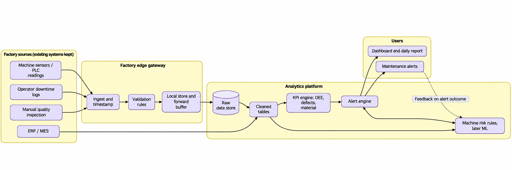

# Manufacturing Intelligence System

A case study for **PrecisionWorks Industries** (Veltris case study, Challenge B / Track B). It looks at production lines, machine sensor readings and material use to find where output is being lost and which machines need attention first.

The repository has the full submission: an analysis notebook, a written report, a slide deck, an architecture diagram and a working prototype that builds a dashboard.

> **All data is illustrative.** It comes from the case study tables. Nothing here is a measured result from a real factory.



## Key findings

| # | Finding | Evidence |
|---|---|---|
| 1 | **Line 2 is the first priority** | Lowest achievement (75.0%), highest defect rate (9.0%) and most downtime (15.6%). It accounts for 300 of the 530 missing units. |
| 2 | **Three machines drive most problems** | M004, M006 and M002 score High risk. Together they account for 68 of 84 machine defects and 7.2 of 8.9 downtime hours. |
| 3 | **Material use is 5% over expected** | 100 kg over across four batches. B002 is worst at +6.7%. |
| 4 | **The data does not reconcile** | Machine downtime (8.9 h) ≠ line downtime (5.0 h), and machine defects (84) ≠ line defects (137). |

### Line KPIs

| Line | Achievement | Defect rate | Downtime | OEE (estimate) |
|---|---|---|---|---|
| Line 1 | 85.0% | 4.0% | 9.4% | 81.6% |
| Line 2 | 75.0% | 9.0% | 15.6% | 68.2% |
| Line 3 | 90.0% | 3.1% | 6.2% | 87.2% |

### Machine risk ranking

| Machine | Risk score | Tier |
|---|---|---|
| M004 | 1.000 | High |
| M006 | 0.813 | High |
| M002 | 0.754 | High |
| M003 | 0.435 | Low |
| M005 | 0.371 | Low |
| M001 | 0.365 | Low |

## Repository contents

| Path | What it is |
|---|---|
| [`01_analysis_notebook.ipynb`](01_analysis_notebook.ipynb) | Step-by-step analysis: line KPIs, machine risk, batch variance, data checks, charts and findings |
| [`03_report.pdf`](03_report.pdf) | Written case study report |
| [`presentation.pptx`](presentation.pptx) | Slide deck summarising the findings and recommendations |
| [`Architecture.png`](Architecture.png) | Proposed system architecture |
| [`ai_usage_declaration.pdf`](ai_usage_declaration.pdf) | Declaration of how AI tools were used |
| [`track_b_prototype/`](track_b_prototype/) | Working prototype: calculations, tests and HTML dashboard ([its own README](track_b_prototype/README.md)) |

```
.
├── 01_analysis_notebook.ipynb
├── 03_report.pdf
├── presentation.pptx
├── Architecture.png
├── ai_usage_declaration.pdf
└── track_b_prototype/
    ├── analysis.py           # all calculations
    ├── build_dashboard.py    # writes dashboard.html
    ├── test_analysis.py      # 13 checks against hand-calculated values
    ├── run.command           # macOS double-click runner
    ├── dashboard.html        # generated dashboard
    └── data/
        ├── line_production.csv    # Dataset B1
        ├── machine_readings.csv   # Dataset B2
        └── batch_material.csv     # Dataset B3
```

## Quick start

The prototype needs **Python 3.9 or newer** and **no third-party packages**.

```bash
git clone https://github.com/sreenidhi-km/Manufacturing-Intelligence-System.git
cd Manufacturing-Intelligence-System/track_b_prototype
```

Run the checks:

```bash
python3 -m unittest test_analysis -v
```

Print the KPIs, risk scores and data warnings:

```bash
python3 analysis.py
```

Build the dashboard and open it:

```bash
python3 build_dashboard.py && open dashboard.html
```

On Linux use `xdg-open dashboard.html`, or just double-click the file. On a Mac you can also double-click `run.command` to do all of the above in one step (the first time, right-click it and choose **Open** if macOS blocks it).

### Running the notebook

The notebook also needs `pandas`, `matplotlib` and Jupyter. It imports `analysis.py`, so it has to run from inside `track_b_prototype/`:

```bash
pip install pandas matplotlib jupyter
```

```bash
cp 01_analysis_notebook.ipynb track_b_prototype/ && cd track_b_prototype && jupyter notebook 01_analysis_notebook.ipynb
```

## Method

**Line KPIs**
- Achievement = actual output ÷ daily target
- Defect rate = defective units ÷ actual output
- Downtime % = downtime hours ÷ 16 scheduled hours
- OEE (estimate) = achievement × quality, where quality = (actual − defective) ÷ actual. This treats the daily target as the ideal rate, so it is an estimate, not a measured OEE.
- Downtime-explained shortfall = downtime hours × target ÷ 16. Downtime explains about 331 of the 530 missing units; the rest has no recorded cause.

**Machine risk score**
- Each signal (vibration, temperature, downtime, defects) is divided by the highest value in the sample, then weighted 0.35 / 0.25 / 0.20 / 0.20.
- Tiers: High ≥ 0.75, Medium ≥ 0.50, Low below that.
- This is a transparent rule, not a trained model. With six machines and no failure labels, a trained model would not be justified.

**Data checks** run automatically and flag mismatched totals between tables, batches that match no line (B004), missing timestamps, and the gap between one day of data and the brief's 30-day evaluation period.

## Limitations

- One day of data, six machines and four batches. Patterns are signals to investigate, not proven causes.
- Vibration, temperature and defects rise together here, but correlation is not cause. A shared factor such as load or bearing age could explain all three.
- Risk tiers are relative to this sample, not to industry alarm limits. Check machines against the manufacturer's limits before acting.
- Batches are matched to lines by output, which is inferred, not stated in the data.
- The 30- and 90-day impact measurements are not implemented. They need timestamped data collected over time.

## Next steps with real data

1. Add timestamps and a line ID to machine readings so they can be reconciled with line data.
2. Record downtime reasons and maintenance actions so the risk score can be validated against real failures.
3. Track the KPIs weekly for 30 days before and after any change so its impact can be measured.

## Author

**K M Sreenidhi**
